# EventFlow V3.0 實際資料庫 ERD（Schema 31）

日期：2026-11-25。以下由 modules/database.js 建立的全新暫存 SQLite 以 PRAGMA table_info／foreign_key_list／index_list 產生；列出已存在的資料表與欄位，不包含規劃中的物件。測試資料庫已關閉清理。

## 已實作關聯圖

```mermaid
erDiagram
  account_messages {
    string id PK
    string token_id FK
    string payload
    string status
    int attempts
    int next_attempt_at
    string last_error
    string created_at
    string sent_at
    string message_id
    string delivery_state
    int lease_until
  }
  account_tokens {
    string id PK
    string kind
    string token_hash
    string email
    string user_id FK
    string organization_id FK
    string role
    string created_by FK
    string created_at
    int expires_at
    string used_at
    string revoked_at
  }
  audit {
    int id PK
    string at
    string user_id
    string action
    string detail
    string organization_id
    string actor_email
    string result
    string target_type
    string target_id
    string request_id
    int status_code
  }
  chat_messages {
    int id PK
    string room_id FK
    string sender_id FK
    string body
    string kind
    int pinned
    string deleted_at
    string created_at
  }
  chat_mutes {
    string room_id PK,FK
    string user_id PK,FK
    int until_at
    string reason
    string created_by FK
  }
  chat_read_states {
    string room_id PK,FK
    string user_id PK,FK
    int last_read_id
    string updated_at
  }
  chat_reports {
    string id PK
    int message_id FK
    string reporter_id FK
    string reason
    string status
    string resolution
    string resolved_by FK
    string created_at
    string resolved_at
  }
  chat_room_members {
    string room_id PK,FK
    string user_id PK,FK
    string state
    string created_at
  }
  chat_rooms {
    string id PK
    string kind
    string event_id FK
    string title
    string direct_key
    string created_by FK
    string created_at
  }
  checkins {
    string id PK
    string registration_id FK
    string checkin_time
    string method
    string operator_id FK
  }
  events {
    string id PK
    string organization_id FK
    string title
    string description
    string date
    string location
    int price
    int capacity
    int max_per_registration
    string status
    int archived
    int review_required
    string custom_fields
    string cover_url
    string category
    int allow_waitlist
    int auto_waitlist
    int member_required
    int chat_enabled
    string chat_join_policy
    string form_settings
    string notification_settings
    string starts_at
    string ends_at
  }
  form_templates {
    string id PK
    string organization_id FK
    string created_by FK
    string name
    string fields
    string settings
    string created_at
    string updated_at
  }
  in_app_notifications {
    int id PK
    string user_id FK
    string kind
    string title
    string body
    string href
    string event_key
    string created_at
    string read_at
  }
  maintenance_state {
    string key PK
    string value
  }
  member_blocks {
    string blocker_id PK,FK
    string blocked_id PK,FK
    string created_at
  }
  member_mail_outbox {
    string id PK
    string user_id FK
    string token_id FK
    string kind
    string payload
    string status
    int attempts
    int next_attempt_at
    string last_error
    string created_at
    string sent_at
    string message_id
    string delivery_state
    int lease_until
  }
  member_profiles {
    string user_id PK,FK
    string public_id
    string full_name
    string phone
    string nickname
    string avatar_url
    string common_answers
    string email_verified_at
    string status
    string created_at
    string updated_at
  }
  member_tokens {
    string id PK
    string user_id FK
    string kind
    string token_hash
    int expires_at
    string used_at
    string created_at
  }
  notification_preferences {
    string user_id PK,FK
    string preferences
    string dm_policy
    int show_presence
  }
  notifications {
    string id PK
    string registration_id FK
    string kind
    string email
    string subject
    string body
    string status
    int attempts
    int next_attempt_at
    string last_error
    string created_at
    string sent_at
    string message_id
    string delivery_state
    int lease_until
  }
  organization_memberships {
    string user_id PK,FK
    string organization_id PK,FK
    string role
    string status
    string staff_mode
    string created_at
    string updated_at
  }
  organizations {
    string id PK
    string name
    string email
    string phone
    string logo_url
    string brand_color
    string hero_url
    string tagline
  }
  registration_requests {
    string key_hash PK
    string event_id FK
    string request_hash
    string registration_id FK
    string created_at
    int expires_at
  }
  registrations {
    string id PK
    string event_id FK
    string name
    string phone
    string email
    int participants
    string notes
    string status
    string custom_answers
    string field_snapshot
    string review_note
    string created_at
    string reviewed_at
    string lookup_code
    string member_user_id FK
  }
  schema_migrations {
    int version PK
    string applied_at
  }
  sessions {
    string token_hash PK
    string user_id FK
    int expires
    string organization_id FK
    string audience
  }
  tickets {
    string registration_id PK,FK
    string token
    string created_at
  }
  user_event_access {
    string user_id PK,FK
    string event_id PK,FK
    int can_review
    int can_checkin
    int can_export
  }
  users {
    string id PK
    string email
    string passhash
    string role
    string organization_id FK
    int disabled
    string staff_mode
  }
  account_tokens ||--o| account_messages : "token_id"
  users o|--o{ account_tokens : "created_by"
  organizations o|--o{ account_tokens : "organization_id"
  users o|--o{ account_tokens : "user_id"
  users ||--o{ chat_messages : "sender_id"
  chat_rooms ||--o{ chat_messages : "room_id"
  users o|--o{ chat_mutes : "created_by"
  users ||--o{ chat_mutes : "user_id"
  chat_rooms ||--o{ chat_mutes : "room_id"
  users ||--o{ chat_read_states : "user_id"
  chat_rooms ||--o{ chat_read_states : "room_id"
  users o|--o{ chat_reports : "resolved_by"
  users o|--o{ chat_reports : "reporter_id"
  chat_messages o|--o{ chat_reports : "message_id"
  users ||--o{ chat_room_members : "user_id"
  chat_rooms ||--o{ chat_room_members : "room_id"
  users o|--o{ chat_rooms : "created_by"
  events o|--o| chat_rooms : "event_id"
  users ||--o{ checkins : "operator_id"
  registrations ||--o| checkins : "registration_id"
  organizations ||--o{ events : "organization_id"
  users o|--o{ form_templates : "created_by"
  organizations o|--o{ form_templates : "organization_id"
  users ||--o{ in_app_notifications : "user_id"
  users ||--o{ member_blocks : "blocked_id"
  users ||--o{ member_blocks : "blocker_id"
  member_tokens o|--o{ member_mail_outbox : "token_id"
  users o|--o{ member_mail_outbox : "user_id"
  users ||--o| member_profiles : "user_id"
  users ||--o{ member_tokens : "user_id"
  users ||--o| notification_preferences : "user_id"
  registrations ||--o{ notifications : "registration_id"
  organizations ||--o{ organization_memberships : "organization_id"
  users ||--o{ organization_memberships : "user_id"
  registrations ||--o| registration_requests : "registration_id"
  events ||--o{ registration_requests : "event_id"
  users o|--o{ registrations : "member_user_id"
  events ||--o{ registrations : "event_id"
  organizations o|--o{ sessions : "organization_id"
  users ||--o{ sessions : "user_id"
  registrations ||--o| tickets : "registration_id"
  events ||--o{ user_event_access : "event_id"
  users ||--o{ user_event_access : "user_id"
  organizations o|--o{ users : "organization_id"
```

## 逐表欄位與限制

### account_messages

| 欄位 | SQLite 型別 | 主鍵／必填 | 預設 |
| --- | --- | --- | --- |
| id | TEXT | PK(1) | — |
| token_id | TEXT | NOT NULL | — |
| payload | TEXT | NOT NULL | — |
| status | TEXT | NOT NULL | 'queued' |
| attempts | INTEGER | NOT NULL | 0 |
| next_attempt_at | INTEGER | NOT NULL | 0 |
| last_error | TEXT | NOT NULL | '' |
| created_at | TEXT | NOT NULL | — |
| sent_at | TEXT |  | — |
| message_id | TEXT | NOT NULL | '' |
| delivery_state | TEXT | NOT NULL | 'unknown' |
| lease_until | INTEGER | NOT NULL | 0 |

外鍵：`token_id → account_tokens.id`。

索引：`sqlite_autoindex_account_messages_2(token_id)` UNIQUE、`sqlite_autoindex_account_messages_1(id)` UNIQUE。

### account_tokens

| 欄位 | SQLite 型別 | 主鍵／必填 | 預設 |
| --- | --- | --- | --- |
| id | TEXT | PK(1) | — |
| kind | TEXT | NOT NULL | — |
| token_hash | TEXT | NOT NULL | — |
| email | TEXT | NOT NULL | — |
| user_id | TEXT |  | — |
| organization_id | TEXT |  | — |
| role | TEXT |  | — |
| created_by | TEXT |  | — |
| created_at | TEXT | NOT NULL | — |
| expires_at | INTEGER | NOT NULL | — |
| used_at | TEXT |  | — |
| revoked_at | TEXT |  | — |

外鍵：`created_by → users.id`、`organization_id → organizations.id`、`user_id → users.id`。

索引：`account_token_email(email,kind,expires_at)`、`sqlite_autoindex_account_tokens_2(token_hash)` UNIQUE、`sqlite_autoindex_account_tokens_1(id)` UNIQUE。

### audit

| 欄位 | SQLite 型別 | 主鍵／必填 | 預設 |
| --- | --- | --- | --- |
| id | INTEGER | PK(1) | — |
| at | TEXT | NOT NULL | — |
| user_id | TEXT |  | — |
| action | TEXT | NOT NULL | — |
| detail | TEXT | NOT NULL | — |
| organization_id | TEXT |  | — |
| actor_email | TEXT | NOT NULL | '' |
| result | TEXT | NOT NULL | 'unknown' |
| target_type | TEXT | NOT NULL | 'legacy' |
| target_id | TEXT | NOT NULL | '' |
| request_id | TEXT | NOT NULL | '' |
| status_code | INTEGER |  | — |

索引：`audit_time_org(organization_id,at,id)`、`audit_action_result(action,result,id)`、`audit_org(organization_id,id)`。

### chat_messages

| 欄位 | SQLite 型別 | 主鍵／必填 | 預設 |
| --- | --- | --- | --- |
| id | INTEGER | PK(1) | — |
| room_id | TEXT | NOT NULL | — |
| sender_id | TEXT | NOT NULL | — |
| body | TEXT | NOT NULL | — |
| kind | TEXT | NOT NULL | 'message' |
| pinned | INTEGER | NOT NULL | 0 |
| deleted_at | TEXT |  | — |
| created_at | TEXT | NOT NULL | — |

外鍵：`sender_id → users.id`、`room_id → chat_rooms.id`。

索引：`chat_messages_room_cursor(room_id,id)`。

### chat_mutes

| 欄位 | SQLite 型別 | 主鍵／必填 | 預設 |
| --- | --- | --- | --- |
| room_id | TEXT | PK(1) / NOT NULL | — |
| user_id | TEXT | PK(2) / NOT NULL | — |
| until_at | INTEGER | NOT NULL | — |
| reason | TEXT | NOT NULL | '' |
| created_by | TEXT |  | — |

外鍵：`created_by → users.id`、`user_id → users.id`、`room_id → chat_rooms.id`。

索引：`sqlite_autoindex_chat_mutes_1(room_id,user_id)` UNIQUE。

### chat_read_states

| 欄位 | SQLite 型別 | 主鍵／必填 | 預設 |
| --- | --- | --- | --- |
| room_id | TEXT | PK(1) / NOT NULL | — |
| user_id | TEXT | PK(2) / NOT NULL | — |
| last_read_id | INTEGER | NOT NULL | 0 |
| updated_at | TEXT | NOT NULL | — |

外鍵：`user_id → users.id`、`room_id → chat_rooms.id`。

索引：`sqlite_autoindex_chat_read_states_1(room_id,user_id)` UNIQUE。

### chat_reports

| 欄位 | SQLite 型別 | 主鍵／必填 | 預設 |
| --- | --- | --- | --- |
| id | TEXT | PK(1) | — |
| message_id | INTEGER |  | — |
| reporter_id | TEXT |  | — |
| reason | TEXT | NOT NULL | — |
| status | TEXT | NOT NULL | 'open' |
| resolution | TEXT | NOT NULL | '' |
| resolved_by | TEXT |  | — |
| created_at | TEXT | NOT NULL | — |
| resolved_at | TEXT |  | — |

外鍵：`resolved_by → users.id`、`reporter_id → users.id`、`message_id → chat_messages.id`。

索引：`chat_reports_status_message(status,message_id,created_at)`、`sqlite_autoindex_chat_reports_1(id)` UNIQUE。

### chat_room_members

| 欄位 | SQLite 型別 | 主鍵／必填 | 預設 |
| --- | --- | --- | --- |
| room_id | TEXT | PK(1) / NOT NULL | — |
| user_id | TEXT | PK(2) / NOT NULL | — |
| state | TEXT | NOT NULL | 'active' |
| created_at | TEXT | NOT NULL | — |

外鍵：`user_id → users.id`、`room_id → chat_rooms.id`。

索引：`chat_members_user(user_id,state,room_id)`、`sqlite_autoindex_chat_room_members_1(room_id,user_id)` UNIQUE。

### chat_rooms

| 欄位 | SQLite 型別 | 主鍵／必填 | 預設 |
| --- | --- | --- | --- |
| id | TEXT | PK(1) | — |
| kind | TEXT | NOT NULL | — |
| event_id | TEXT |  | — |
| title | TEXT | NOT NULL | — |
| direct_key | TEXT |  | — |
| created_by | TEXT |  | — |
| created_at | TEXT | NOT NULL | — |

外鍵：`created_by → users.id`、`event_id → events.id`。

索引：`sqlite_autoindex_chat_rooms_3(direct_key)` UNIQUE、`sqlite_autoindex_chat_rooms_2(event_id)` UNIQUE、`sqlite_autoindex_chat_rooms_1(id)` UNIQUE。

### checkins

| 欄位 | SQLite 型別 | 主鍵／必填 | 預設 |
| --- | --- | --- | --- |
| id | TEXT | PK(1) | — |
| registration_id | TEXT | NOT NULL | — |
| checkin_time | TEXT | NOT NULL | — |
| method | TEXT | NOT NULL | — |
| operator_id | TEXT | NOT NULL | — |

外鍵：`operator_id → users.id`、`registration_id → registrations.id`。

索引：`sqlite_autoindex_checkins_2(registration_id)` UNIQUE、`sqlite_autoindex_checkins_1(id)` UNIQUE。

### events

| 欄位 | SQLite 型別 | 主鍵／必填 | 預設 |
| --- | --- | --- | --- |
| id | TEXT | PK(1) | — |
| organization_id | TEXT | NOT NULL | — |
| title | TEXT | NOT NULL | — |
| description | TEXT | NOT NULL | '' |
| date | TEXT | NOT NULL | '' |
| location | TEXT | NOT NULL | '' |
| price | INTEGER | NOT NULL | 0 |
| capacity | INTEGER | NOT NULL | — |
| max_per_registration | INTEGER | NOT NULL | 4 |
| status | TEXT | NOT NULL | 'open' |
| archived | INTEGER | NOT NULL | 0 |
| review_required | INTEGER | NOT NULL | 0 |
| custom_fields | TEXT | NOT NULL | '[]' |
| cover_url | TEXT | NOT NULL | '' |
| category | TEXT | NOT NULL | '體驗' |
| allow_waitlist | INTEGER | NOT NULL | 0 |
| auto_waitlist | INTEGER | NOT NULL | 1 |
| member_required | INTEGER | NOT NULL | 0 |
| chat_enabled | INTEGER | NOT NULL | 0 |
| chat_join_policy | TEXT | NOT NULL | 'confirmed' |
| form_settings | TEXT | NOT NULL | '{}' |
| notification_settings | TEXT | NOT NULL | '{}' |
| starts_at | TEXT | NOT NULL | '' |
| ends_at | TEXT | NOT NULL | '' |

外鍵：`organization_id → organizations.id`。

索引：`event_org(organization_id)`、`sqlite_autoindex_events_1(id)` UNIQUE。

### form_templates

| 欄位 | SQLite 型別 | 主鍵／必填 | 預設 |
| --- | --- | --- | --- |
| id | TEXT | PK(1) | — |
| organization_id | TEXT |  | — |
| created_by | TEXT |  | — |
| name | TEXT | NOT NULL | — |
| fields | TEXT | NOT NULL | — |
| settings | TEXT | NOT NULL | '{}' |
| created_at | TEXT | NOT NULL | — |
| updated_at | TEXT | NOT NULL | — |

外鍵：`created_by → users.id`、`organization_id → organizations.id`。

索引：`form_templates_org(organization_id,name)`、`sqlite_autoindex_form_templates_1(id)` UNIQUE。

### in_app_notifications

| 欄位 | SQLite 型別 | 主鍵／必填 | 預設 |
| --- | --- | --- | --- |
| id | INTEGER | PK(1) | — |
| user_id | TEXT | NOT NULL | — |
| kind | TEXT | NOT NULL | — |
| title | TEXT | NOT NULL | — |
| body | TEXT | NOT NULL | '' |
| href | TEXT | NOT NULL | '/member.html' |
| event_key | TEXT |  | — |
| created_at | TEXT | NOT NULL | — |
| read_at | TEXT |  | — |

外鍵：`user_id → users.id`。

索引：`member_notifications_kind(user_id,kind,id)`、`member_notifications_unread(user_id,read_at,id)`、`sqlite_autoindex_in_app_notifications_1(user_id,event_key)` UNIQUE。

### maintenance_state

| 欄位 | SQLite 型別 | 主鍵／必填 | 預設 |
| --- | --- | --- | --- |
| key | TEXT | PK(1) | — |
| value | TEXT | NOT NULL | — |

索引：`sqlite_autoindex_maintenance_state_1(key)` UNIQUE。

### member_blocks

| 欄位 | SQLite 型別 | 主鍵／必填 | 預設 |
| --- | --- | --- | --- |
| blocker_id | TEXT | PK(1) / NOT NULL | — |
| blocked_id | TEXT | PK(2) / NOT NULL | — |
| created_at | TEXT | NOT NULL | — |

外鍵：`blocked_id → users.id`、`blocker_id → users.id`。

索引：`chat_blocks_target(blocked_id,blocker_id)`、`sqlite_autoindex_member_blocks_1(blocker_id,blocked_id)` UNIQUE。

### member_mail_outbox

| 欄位 | SQLite 型別 | 主鍵／必填 | 預設 |
| --- | --- | --- | --- |
| id | TEXT | PK(1) | — |
| user_id | TEXT |  | — |
| token_id | TEXT |  | — |
| kind | TEXT |  | — |
| payload | TEXT | NOT NULL | — |
| status | TEXT | NOT NULL | 'queued' |
| attempts | INTEGER | NOT NULL | 0 |
| next_attempt_at | INTEGER | NOT NULL | 0 |
| last_error | TEXT | NOT NULL | '' |
| created_at | TEXT | NOT NULL | — |
| sent_at | TEXT |  | — |
| message_id | TEXT | NOT NULL | '' |
| delivery_state | TEXT | NOT NULL | 'unknown' |
| lease_until | INTEGER | NOT NULL | 0 |

外鍵：`token_id → member_tokens.id`、`user_id → users.id`。

索引：`member_mail_pending(status,next_attempt_at)`、`sqlite_autoindex_member_mail_outbox_1(id)` UNIQUE。

### member_profiles

| 欄位 | SQLite 型別 | 主鍵／必填 | 預設 |
| --- | --- | --- | --- |
| user_id | TEXT | PK(1) | — |
| public_id | TEXT | NOT NULL | — |
| full_name | TEXT | NOT NULL | '' |
| phone | TEXT | NOT NULL | '' |
| nickname | TEXT | NOT NULL | — |
| avatar_url | TEXT | NOT NULL | '' |
| common_answers | TEXT | NOT NULL | '{}' |
| email_verified_at | TEXT |  | — |
| status | TEXT | NOT NULL | 'active' |
| created_at | TEXT | NOT NULL | — |
| updated_at | TEXT | NOT NULL | — |

外鍵：`user_id → users.id`。

索引：`sqlite_autoindex_member_profiles_2(public_id)` UNIQUE、`sqlite_autoindex_member_profiles_1(user_id)` UNIQUE。

### member_tokens

| 欄位 | SQLite 型別 | 主鍵／必填 | 預設 |
| --- | --- | --- | --- |
| id | TEXT | PK(1) | — |
| user_id | TEXT | NOT NULL | — |
| kind | TEXT | NOT NULL | — |
| token_hash | TEXT | NOT NULL | — |
| expires_at | INTEGER | NOT NULL | — |
| used_at | TEXT |  | — |
| created_at | TEXT | NOT NULL | — |

外鍵：`user_id → users.id`。

索引：`member_tokens_expiry(user_id,kind,expires_at)`、`sqlite_autoindex_member_tokens_2(token_hash)` UNIQUE、`sqlite_autoindex_member_tokens_1(id)` UNIQUE。

### notification_preferences

| 欄位 | SQLite 型別 | 主鍵／必填 | 預設 |
| --- | --- | --- | --- |
| user_id | TEXT | PK(1) | — |
| preferences | TEXT | NOT NULL | '{}' |
| dm_policy | TEXT | NOT NULL | 'requests' |
| show_presence | INTEGER | NOT NULL | 1 |

外鍵：`user_id → users.id`。

索引：`sqlite_autoindex_notification_preferences_1(user_id)` UNIQUE。

### notifications

| 欄位 | SQLite 型別 | 主鍵／必填 | 預設 |
| --- | --- | --- | --- |
| id | TEXT | PK(1) | — |
| registration_id | TEXT | NOT NULL | — |
| kind | TEXT | NOT NULL | — |
| email | TEXT | NOT NULL | — |
| subject | TEXT | NOT NULL | — |
| body | TEXT | NOT NULL | — |
| status | TEXT | NOT NULL | 'queued' |
| attempts | INTEGER | NOT NULL | 0 |
| next_attempt_at | INTEGER | NOT NULL | 0 |
| last_error | TEXT | NOT NULL | '' |
| created_at | TEXT | NOT NULL | — |
| sent_at | TEXT |  | — |
| message_id | TEXT | NOT NULL | '' |
| delivery_state | TEXT | NOT NULL | 'unknown' |
| lease_until | INTEGER | NOT NULL | 0 |

外鍵：`registration_id → registrations.id`。

索引：`sqlite_autoindex_notifications_2(registration_id,kind)` UNIQUE、`sqlite_autoindex_notifications_1(id)` UNIQUE。

### organization_memberships

| 欄位 | SQLite 型別 | 主鍵／必填 | 預設 |
| --- | --- | --- | --- |
| user_id | TEXT | PK(1) / NOT NULL | — |
| organization_id | TEXT | PK(2) / NOT NULL | — |
| role | TEXT | NOT NULL | — |
| status | TEXT | NOT NULL | 'active' |
| staff_mode | TEXT | NOT NULL | 'assigned' |
| created_at | TEXT | NOT NULL | — |
| updated_at | TEXT | NOT NULL | — |

外鍵：`organization_id → organizations.id`、`user_id → users.id`。

索引：`membership_org_active(organization_id,status,role,user_id)`、`sqlite_autoindex_organization_memberships_1(user_id,organization_id)` UNIQUE。

### organizations

| 欄位 | SQLite 型別 | 主鍵／必填 | 預設 |
| --- | --- | --- | --- |
| id | TEXT | PK(1) | — |
| name | TEXT | NOT NULL | — |
| email | TEXT |  | '' |
| phone | TEXT |  | '' |
| logo_url | TEXT | NOT NULL | '' |
| brand_color | TEXT | NOT NULL | '#4658ba' |
| hero_url | TEXT | NOT NULL | '' |
| tagline | TEXT | NOT NULL | '' |

索引：`sqlite_autoindex_organizations_1(id)` UNIQUE。

### registration_requests

| 欄位 | SQLite 型別 | 主鍵／必填 | 預設 |
| --- | --- | --- | --- |
| key_hash | TEXT | PK(1) / NOT NULL | — |
| event_id | TEXT | NOT NULL | — |
| request_hash | TEXT | NOT NULL | — |
| registration_id | TEXT | NOT NULL | — |
| created_at | TEXT | NOT NULL | — |
| expires_at | INTEGER | NOT NULL | — |

外鍵：`registration_id → registrations.id`、`event_id → events.id`。

索引：`registration_request_expiry(expires_at)`、`sqlite_autoindex_registration_requests_2(registration_id)` UNIQUE、`sqlite_autoindex_registration_requests_1(key_hash)` UNIQUE。

### registrations

| 欄位 | SQLite 型別 | 主鍵／必填 | 預設 |
| --- | --- | --- | --- |
| id | TEXT | PK(1) | — |
| event_id | TEXT | NOT NULL | — |
| name | TEXT | NOT NULL | — |
| phone | TEXT | NOT NULL | — |
| email | TEXT | NOT NULL | — |
| participants | INTEGER | NOT NULL | — |
| notes | TEXT | NOT NULL | '' |
| status | TEXT | NOT NULL | — |
| custom_answers | TEXT | NOT NULL | '{}' |
| field_snapshot | TEXT | NOT NULL | '[]' |
| review_note | TEXT | NOT NULL | '' |
| created_at | TEXT | NOT NULL | — |
| reviewed_at | TEXT |  | — |
| lookup_code | TEXT | NOT NULL | '' |
| member_user_id | TEXT |  | — |

外鍵：`member_user_id → users.id`、`event_id → events.id`。

索引：`registration_member_status(member_user_id,status,created_at)`、`registration_event_status(event_id,status,created_at,participants)`、`registration_event(event_id)`、`sqlite_autoindex_registrations_1(id)` UNIQUE。

### schema_migrations

| 欄位 | SQLite 型別 | 主鍵／必填 | 預設 |
| --- | --- | --- | --- |
| version | INTEGER | PK(1) | — |
| applied_at | TEXT | NOT NULL | — |

### sessions

| 欄位 | SQLite 型別 | 主鍵／必填 | 預設 |
| --- | --- | --- | --- |
| token_hash | TEXT | PK(1) | — |
| user_id | TEXT | NOT NULL | — |
| expires | INTEGER | NOT NULL | — |
| organization_id | TEXT |  | — |
| audience | TEXT | NOT NULL | 'admin' |

外鍵：`organization_id → organizations.id`、`user_id → users.id`。

索引：`session_audience_user(audience,user_id,expires)`、`session_user(user_id)`、`sqlite_autoindex_sessions_1(token_hash)` UNIQUE。

### tickets

| 欄位 | SQLite 型別 | 主鍵／必填 | 預設 |
| --- | --- | --- | --- |
| registration_id | TEXT | PK(1) | — |
| token | TEXT | NOT NULL | — |
| created_at | TEXT | NOT NULL | — |

外鍵：`registration_id → registrations.id`。

索引：`sqlite_autoindex_tickets_2(token)` UNIQUE、`sqlite_autoindex_tickets_1(registration_id)` UNIQUE。

### user_event_access

| 欄位 | SQLite 型別 | 主鍵／必填 | 預設 |
| --- | --- | --- | --- |
| user_id | TEXT | PK(1) / NOT NULL | — |
| event_id | TEXT | PK(2) / NOT NULL | — |
| can_review | INTEGER | NOT NULL | — |
| can_checkin | INTEGER | NOT NULL | — |
| can_export | INTEGER | NOT NULL | — |

外鍵：`event_id → events.id`、`user_id → users.id`。

索引：`sqlite_autoindex_user_event_access_1(user_id,event_id)` UNIQUE。

### users

| 欄位 | SQLite 型別 | 主鍵／必填 | 預設 |
| --- | --- | --- | --- |
| id | TEXT | PK(1) | — |
| email | TEXT | NOT NULL | — |
| passhash | TEXT | NOT NULL | — |
| role | TEXT | NOT NULL | — |
| organization_id | TEXT |  | — |
| disabled | INTEGER | NOT NULL | 0 |
| staff_mode | TEXT | NOT NULL | 'organization' |

外鍵：`organization_id → organizations.id`。

索引：`sqlite_autoindex_users_2(email)` UNIQUE、`sqlite_autoindex_users_1(id)` UNIQUE。

## 遷移與身份規則

- Schema 30 的 organization_memberships／registration_requests 保留；31 只增量新增會員、表單、社群、通知資料及欄位。
- users 是單一身份來源，一般會員 role=member、organization_id 可為 NULL，不自動建立後台組織資格。sessions.audience 與獨立 Cookie 分開 member／admin 用途。
- registrations.member_user_id 原始訪客資料保持 NULL，必須登入並完成 Email 驗證，且提供對應查詢憑證才可安全綁定；不得 Email-only 自動認領。
- member_profiles 停用／刪除申請採軟狀態，保留報名、聊天及稽核歷史。
- chat_rooms.direct_key UNIQUE 防止同一對會員重複建一對一聊天室；chat_messages(room_id,id) 支援游標分頁。
- in_app_notifications(user_id,event_key) UNIQUE 用於真實事件去重，未讀依 user_id／read_at 查詢。
- 頭像、活動圖片與加密郵件金鑰屬檔案備份範圍，不畫成不存在的二進位資料表。
- 實際 CHECK、Trigger 與遷移交易以 modules/database.js 為準；此圖不是對未驗證正式資料庫的宣稱。
