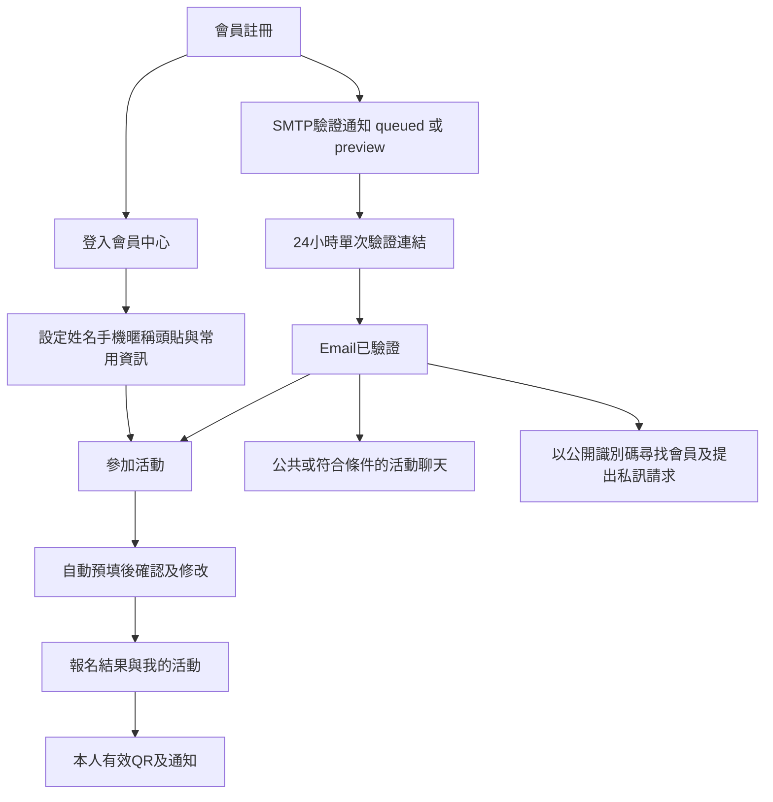
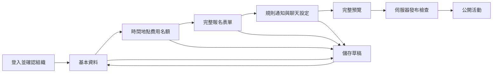

# EventFlow V3.0 使用、部署與相容性

日期：2026-11-25。一般會員社群擴充以既有開發分支 `919443a` 為基礎，保留版本 3.0.0 並增量至 SQLite schema 31，不覆蓋前次多組織成果。GitHub main 檢查基準為 `d27663b`，Docker／Coolify 設定保留。開發分支 `codex/eventflow-v3.0`；由使用者驗收後決定合併，本次不直接合併 main。

## 啟動與設定

```powershell
cd D:\Coding\EventFlow
npm ci
npm run check
npm test
npm start
```

先停止舊服務，再啟動新版。Node.js 24+；新增 Socket.IO／socket.io-client 4.8.4，lockfile 固定實際安裝版本。前台 `/`、會員 `/member.html`、社群 `/community.html`、後台 `/admin.html`、表單設計器 `/form-builder.html`、藍圖 `/blueprint.html`。

保留 HOST、PORT、EVENTFLOW_DATA_DIR、EVENTFLOW_UPLOADS_DIR、BACKUP_DIR、BACKUP_INTERVAL_MINUTES、AUDIT_RETENTION_DAYS、PUBLIC_BASE_URL、SMTP_*、COOKIE_SECURE、TRUST_PROXY 設定。程式不自動讀取 .env，使用環境變數或 Node 原生 `--env-file`。初始 owner 仍在本機透過後台建立，一般會員註冊不取代管理員設定。

會員驗證及重設需要 SMTP_HOST、SMTP_FROM，以及實際可存取的 PUBLIC_BASE_URL（公開 origin）。未設定時通知為 preview、驗證信未寄出，沒有任意取得驗證 Token 的開發捷徑。自動測試驗證加密郵件佇列，不代表真實 SMTP 已投遞。

## 同一身份、兩種登入用途

users 是單一帳號身份。一般註冊建立 `role=member`、`organization_id=NULL` 及 member_profiles，不自動建立 organization_memberships。公開會員使用 ef_member_session／audience member；後台使用 ef_session／audience admin，改 Cookie 名稱也不能跨用途取得權限。

管理帳號可以用正確既有密碼登入會員中心開通公開 profile，不重複建立 users，也不自動驗證 Email。停用公開 profile／提出刪除申請只停止會員用途，不順帶停用原管理資格；變更共同密碼則撤銷兩種用途的所有 Session。

明確組織邀請才可讓一般會員取得 staff／admin 資格：需匹配已驗證會員 Session、CSRF 與有效單次 Token，接受時重驗 issuer。不因註冊／登入升權，新增組織資格後仍要另行後台登入。管理用途與會員用途各自保護。

## 會員使用路徑



註冊不表示 Email 已驗證。未驗證者可登入編輯個資，但會員關聯報名、聊天室與安全綁定需先驗證。會員限定活動拒絕未登入／未驗證報名；原活動預設仍允許訪客，既有訪客不必重新註冊。

個人中心提供個資、我的活動與狀態分類、本人 QR、通知、隱私與帳號安全。預填不覆寫已輸入的內容；單次報名修改不自動同步 profile，改 profile 不改歷史名字／手機／答案及 field_snapshot。

舊訪客報名不依 Email 自動認領。需已驗證會員 Email、原報名編號與查詢碼且 Email 相符，才可綁定；不能取代其他會員的既有綁定。會員中心看本人報名不必每次輸入查詢碼，訪客舊查詢機制保留。

停用或刪除申請需目前密碼，採軟狀態並保留活動、聊天與稽核歷史，沒有假裝已永久刪除所有資料。目前沒有變更登入 Email、自助取消刪除申請或完整永久刪除審批工作台。

## 後台與活動精靈

側欄按營運、活動、報名、表單、社群、分析與組織／系統分組。保留品牌、圖片、組織、成員、逐活動權限、候補、Email、核銷、CSV、報表、稽核及備份。角色由後端驗證，隱藏按鈕不是授權。無付款模型，不提供假付款狀態。



精靈先保存 draft，再以獨立 publish API 檢查名稱、日期、地點、名額與有效表單。不合條件保留草稿、不假發布。舊 API 直接建立 open 活動的相容路徑保留，不把新精靈變成破壞性必填要求。

Dashboard 的活動、人數、台北今日簽到、近期活動、失敗通知與待處理檢舉來自資料庫並套用授權。有效人數含 confirmed／pending／waitlisted。組織管理員只能管理自己的活動社群，私人檢舉只讓全域 owner 取得必要被檢舉訊息並稽核，不提供任意私訊瀏覽。

## 獨立表單設計器

`/form-builder.html?event=<活動ID>` 提供元件、完整預覽、屬性三區，窄螢幕上下配置。姓名、手機、Email、報名人數不能刪除，備註保留。

額外欄位支援文字、多行、數字、日期、下拉、單選、多選及同意條款；可排序、必填、設定預設值／提示／長度與數值界線，不接受任意 regex。七個內建範本為一般活動、旅遊團、課程、講座、聚餐、比賽與空白；內建不可覆寫，可另存組織範本。

測試填寫只做前端驗證，不建立正式報名。保存活動更新 customFields／formSettings，既有 field_snapshot 不變。多選為字串陣列、同意為布林，舊字串／數字答案與 JSON keys 保留。伺服器仍驗證所有必要欄位。

## 文字社群與訊息

`/community.html` 提供公共、活動及一對一聊天室。已驗證會員可進公共，活動依 members／confirmed／staff 規則。取消、封存、關閉聊天、資格、封鎖與 Session 失效會重新驗證，不能只信任第一次加入時的權限。

新私訊偏好 open／requests／closed：requests 需接收者接受，接受前雙方不能讀傳訊息；closed 禁止新對話，已有接受的對話保留；封鎖才拒絕雙方對話存取。canonical direct_key 唯一識別一對會員，不重複建房。被拒絕的同一對話目前不能自行重新申請。

訊息 1–2000 字、有限流、純文字渲染。歷史用游標分頁，重連後 afterId 補訊。已讀游標只能是本房訊息且單調遞增。對外顯示暱稱、頭像與時間，不公開他人 Email／手機；typing 不持久化，在線狀態可隱藏。

管理員可按權限公告、置頂、禁言與處理檢舉。沒有一般管理員任意私人歷史路由；全域 owner 只透過檢舉取得必要內容並稽核。沒有語音／視訊、大檔、端到端加密或離線傳送佇列。

## 通知與 Email

報名、審核、遞補、活動取消／時間異動／即將開始、公告、私訊、請求與提及均由真實事件產生，持久化後推送本人。可分類、未讀、單筆／全部已讀、開連結與設定偏好；事件 key 去重，回滾後不推不存在的通知。

目前會員偏好控制站內通知，不等同 SMTP 退訂。活動 reminders 控制即將開始提醒；announcements=false 禁止該活動公告通知，但公告訊息仍保存及顯示。排程每 60 秒檢查，有 starts_at 時針對未來 24 小時，僅日期時為台北當日活動，只有 confirmed 報名收到提醒。

queued／retry 等待，preview 明確未寄送，sent／accepted 只表示 SMTP 接受，不等於送達收件匣。名額交易不依賴 SMTP 成功，不確定投遞不自動重寄。最終送達／退信 Webhook 未實作。

## 遷移、備份與還原

Migration 31 先建立一致性 pre-v31 備份，再交易加入表、欄位、索引與 seed，驗證外鍵／完整性才提交；重啟不重複遷移。schema 30 多組織資格及報名重送映射保留；舊訪客 member_user_id 留 NULL。ERD_V3.0.md 由暫存實際 SQLite 的 PRAGMA 產生。

完整快照包含 SQLite、uploads（含頭像）及 account-mail.key；schema 31 驗證必要表、會員、上傳引用與加密郵件金鑰。相容舊 29／30 快照。

```powershell
npm run maintenance -- backup
npm run maintenance -- verify --backup '完整快照的絕對路徑'
npm run maintenance -- restore --backup '完整快照的絕對路徑' --target '不存在的新目錄絕對路徑'
```

還原前停服務並另存目前資料；只接受全新目錄，不覆蓋正式來源。還原保留會員、活動、報名、聊天歷史，撤兩種 Session／未使用 Token，暫停待送郵件。以相容程式、另一 Port、EVENTFLOW_DATA_DIR／EVENTFLOW_UPLOADS_DIR 指向新副本，停 SMTP 做驗證，通過才正式切換。程式／依賴／SMTP 憑證不含在資料快照。

備份依服務存活、不自動刪除；稽核預設永久保留，啟用留存清理前先完整封存。快照含個資與郵件金鑰，需受保護儲存；SHA-256 不等於防竄改簽章或異地加密。

## Docker／Coolify 與待驗收

既有 Dockerfile／.dockerignore 保留，Node 24、非 root、健康檢查與持久資料目錄沿用。需確保資料／uploads／backups 持久化、PUBLIC_BASE_URL 為公開 origin、HTTPS 正確轉送 Host 並允許 Socket.IO WebSocket upgrade 與 polling。COOKIE_SECURE／代理信任按真實環境設定，文件不宣稱完成外部部署驗收。

最終自動測試數、正式來源 schema、備份路徑、Commit 與 push 結果由主代理填入 TEST_RESULTS_V3.0.md／開發報告。真實 SMTP、HTTPS／Coolify、實體手機 QR、完整裝置／讀屏、長時間排程、正式還原切換、負載及滲透仍需驗收。速率與 Socket adapter 為單程序；共享限流、異地加密、外部不可變稽核與專業監控未完成。原 `/api/health` 是基本程序健康，不代表完整監控告警平台。


安全補充：modules/identity-security.js 統一共享身份密碼變更的撤銷；後台／會員重設、會員變更密碼及 owner 設密碼皆撤銷兩種 Session 與所有未使用 reset 連結。個人停用／刪除只更新 profile 請求狀態，不自動抹除歷史；實際刪除處理與恢復由管理維運流程執行。
