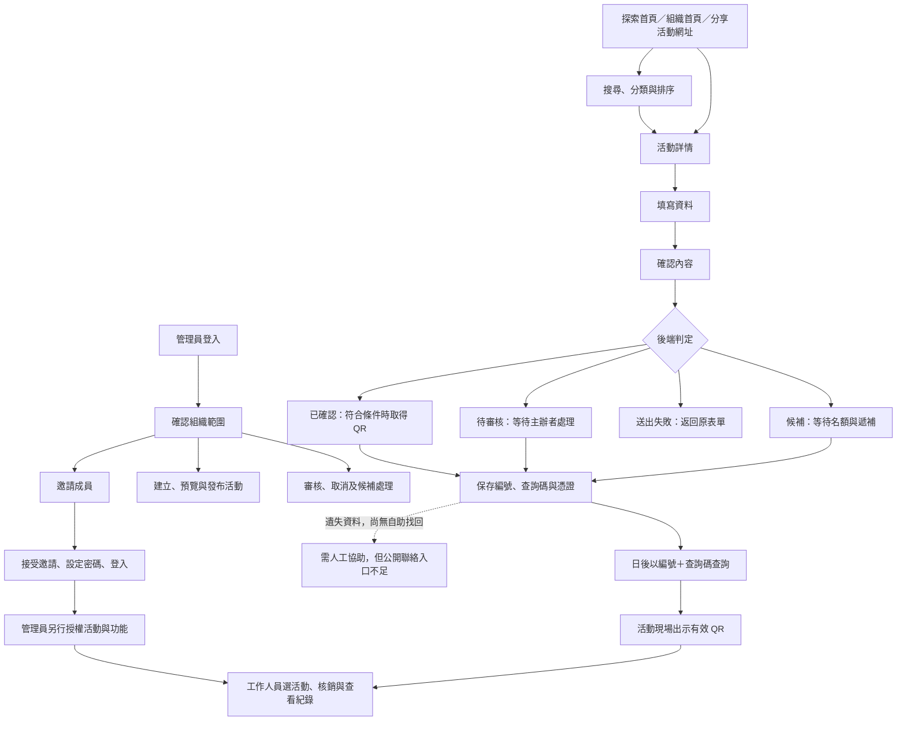

# EventFlow V2.9 使用者 UX 路徑盤點

盤點日期：2026-10-28。依據本機提交 `0bf4b42`。本次只做 UX 與路徑盤點，未修改應用程式、API、資料庫或正式資料。

## 1. 結論與證據界線

首次「找到活動 → 填寫 → 確認 → 取得結果」已有完整主路徑。接下來的主要問題是回訪、錯誤復原、身份切換及成員開通，尤其「已報名卻找不到憑證」「不知道候補接下來怎麼辦」「加入後沒有可操作活動」。這是依程式推導的風險，尚無使用者訪談、漏斗數據或流失率可證明發生頻率。

本次重新閱讀前後台頁面、互動腳本、帳號／候補／通知邏輯、README 與既有測試紀錄。證據標記：

- **S：本次原始碼確認**，可指出控制流程與缺口；不等於本次瀏覽器重現。
- **B：沿用 V2.9 既有瀏覽器基本檢查**，來源為 TEST_RESULTS_V2.9.md，不冒充本次重測。
- **V：待驗證推論**，需要真實使用者、隔離環境或裝置驗證。
- **建議：尚未實作的設計**，沒有標示成已完成。

本次沒有重新執行 npm test 或操作正式服務。既有 15 項測試驗證功能及授權，不能視為 UX 全面通過。沒有採用一般使用者「可能不知道」作為已發生的客訴。

## 2. 角色、目標與成功標準

| 角色 | 主要目標 | 真正完成的時刻 |
| --- | --- | --- |
| 新訪客 | 找到合適活動，理解是否能參加 | 清楚時間、地點、費用、名額及審核／候補規則，能做出報名決定 |
| 首次報名者 | 安心完成一次有效報名 | 看懂最後狀態，保存編號與查詢碼，知道下一步；待審核／候補不被誤認為已錄取 |
| 回訪報名者 | 查進度、找憑證、活動當天入場 | 跨時間仍可取得有效狀態與 QR，遺失資料有安全復原方式 |
| 組織管理員 admin | 建立活動、處理報名、安排工作人員 | 活動公開且可預覽；審核結果明確；邀請成員可真正開始工作 |
| 工作人員 staff | 快速查看授權活動並核銷 | 不需理解全部後台即可選對活動、完成正確核銷、處理重複與異常 |
| 系統管理員 owner | 管理組織及維運 | 明確知道目前組織範圍、備份是否有效、異常怎麼處理 |

報名訪客沒有一般會員登入流程；`account.html` 的邀請／密碼重設屬於後台帳號，不應把它當成報名查詢碼找回功能。

## 3. 現況路徑總圖

「使用者取消／修改報名」「遺失查詢碼找回」「已存在帳號加入第二組織」目前沒有對應的完整自助路徑，不放進已完成主線。

## 4. 逐條路徑盤點

| 路徑 | 入口 → 操作 → 結果 | 已具備 | 主要中斷點／待補 |
| --- | --- | --- | --- |
| J01 探索活動 | `/` 或 `/?org=` → 搜尋／分類／排序 → 整卡開啟 | 日期、地點、費用、名額、狀態；載入／空結果／重試（S，部分 B） | 返回列表後搜尋與分類未由網址保存；無活動與無搜尋結果共用提示 |
| J02 判斷是否參加 | 分享網址或列表 → `/event.html?id=` → 報名 | 詳情獨立、主辦單位、剩餘名額、分享及手機入口（S、B） | 無結構化起訖時間、交通、公開聯絡方式；付費活動未交代付款方式 |
| J03 一般報名 | 詳情 → 表單 → 確認 → `/result.html` | 必填／選填、自訂欄位、即時錯誤、送出鎖定、結果分流（S、B） | 表單階段沒有持續可見的完整活動摘要；重新整理／離頁後沒有草稿復原 |
| J04 報名錯誤 | 驗證錯誤／API 失敗 → 修正原資料 → 重送 | API 拒絕後保留輸入，重複報名提示（S、B） | 網路中斷無法區分「未建立」與「已建立但回應遺失」，可能陷入重複報名提示 |
| J05 待審核／候補 | 結果頁 → 等待通知 → 再查詢 → 確認或其他結果 | 狀態文案有區分，無效資格不發 QR（S；後端有既有測試） | 沒有預計回覆時間、候補整組規則摘要、聯絡／取消入口；不是承諾可預測名次 |
| J06 回訪與找 QR | 編號＋查詢碼 → 首頁查詢／結果頁 → QR | 可查狀態、下載 QR、複製結果（S、部分 B） | 結果憑證主要存於 sessionStorage；遺失查詢碼沒有自助找回；一般通知也要求原查詢碼 |
| J07 活動異動與售後 | 要修改人數／取消／詢問 → 尋找主辦者 | 管理員後端可取消部分狀態（S） | 訪客無自助修改／取消，公開詳情只顯示主辦名稱，未形成清楚人工替代路徑 |
| J08 管理員開活動 | 登入 → 選組織 → 建立表單 → 圖片／品牌 → 前台預覽 | 既有活動表單、預覽連結、自訂欄位、編輯與封存（S） | 活動、圖片及品牌分散；沒有從草稿到公開的完成清單或發布前摘要 |
| J09 管理報名 | Dashboard／活動 → 報名表 → 審核／遞補／取消 | 搜尋、狀態篩選、批次處理、手動遞補（S） | 審核後只重載報名列表，Dashboard／其他統計沒有同時更新；候補／待審核的部分操作後端有但 UI 沒入口 |
| J10 邀請與開通 | 成員頁 → 邀請 → 接受 → 登入 → 另授權 | 一次性連結、遮罩 Email、預設最小權限（S；後端有既有測試） | admin 邀請欄位漏送；接受與授權未串成可追蹤的開通流程，0 場活動缺下一步 |
| J11 忘記密碼 | 登入頁 → 輸入 Email → 收信 → 設定 → 返回登入 | 不枚舉帳號、限時單次連結（S；後端有既有測試） | 未設定 SMTP 時仍可提交；失效／過期連結缺少就地重新申請入口 |
| J12 現場核銷 | 登入 → 選授權活動 → 相機／圖片／手動 → 核銷結果 | 活動權限、三種入口、成功與錯誤、歷史紀錄（S） | 每次讀到 QR 即停止相機；整組核銷需更明顯提示；沒有已實作的離線核銷能力 |
| J13 維運與復原 | owner 全域 → 通知／稽核／快照 → 驗證／維護工具 | 投遞狀態、分頁、備份驗證、離線還原文件（S） | 非全域 owner 看得到備份導覽但操作需切回全域；uncertain 錯誤缺少操作指引，還原需離開 UI |

## 5. 改善清單與優先順序

P1：會阻斷核心任務、遺失成果或造成重要誤解，應先修。P2：增加理解與操作成本，下一輪改善。P3：便利性與品質提升。此為影響程度判斷，沒有虛構流失率、收益或工期。

| 編號／優先 | 發現與證據 | 建議處理 | 可驗收條件 |
| --- | --- | --- | --- |
| UX01 / P1 | **admin 邀請會漏送必要欄位（S）**：governance.js 停用 inviteOrg／inviteRole；upgrade29.js 以 FormData 送出，被 disabled 的控制項不會包含在資料內，accounts.js 又要求兩個欄位 | 明確組合固定組織／角色值，後端照常驗證；不能只移除後端驗證 | 真實 admin UI 可邀請本組織 staff；跨組織及邀請 admin 仍被拒絕 |
| UX02 / P1 | **結果無法可靠找回（S、V）**：sessionStorage 不提供跨裝置長期保存；一般郵件只附編號並要求原查詢碼，沒有找回入口 | 結果頁先明確提醒保存；提供經 Email 驗證、限時且不枚舉帳號的安全找回流程；公開人工聯絡入口 | 關閉原分頁、換裝置、遺失查詢碼後，有安全且可理解的復原路徑；不可直接讓後台顯示全部私密查詢碼代替驗證 |
| UX03 / P1 | **送出結果不確定（S、V）**：submit 遇網路失敗保留表單，但無持久請求識別與安全恢復；後端可能已寫入，再送出會被擋為重複 | 增加報名請求冪等與結果恢復，提示「正在確認送出結果」；不能直接顯示報名失敗或任意重新建立 | 隔離測試模擬寫入後回應遺失，再試只得到同一筆報名，且能恢復查詢資格 |
| UX04 / P1 | **身份切換清理缺口（S、V）**：clearPrivateData 未清空 inviteResult、inviteRows、snapshotRows，亦未 reset inviteForm；原始碼確認缺口，跨身份可見範圍尚待重現 | 登出／權限變動時清空邀請連結、名單及維運摘要，按新角色重建畫面 | owner → 登出 → staff／其他 admin，包含深連結與切換組織，不顯示上一身份殘留資料；不修改後端隔離規則 |
| UX05 / P2 | **組織探索上下文流失（S）**：詳情、結果的探索／返回連結多回 `/`，分享網址也不含 org；列表篩選沒有同步網址 | 保留 org、搜尋、分類、排序及返回位置；活動分享由活動所屬組織推導品牌 | 從組織首頁篩選、報名、返回後仍在同組織及原條件；全站探索可明確退出此範圍 |
| UX06 / P2 | **費用資訊不足（S）**：只顯示單一活動費用，確認頁缺費用摘要；沒有支付流程，也未說明付款安排 | 定義價格單位（每人／每筆）、是否含稅及付款方式；若不收線上款明確說明；依定義顯示應付摘要 | 非零價格、多人報名能理解總額與付款下一步；不能把「已確認」自行改成「已付款」 |
| UX07 / P2 | **審核／候補下一步不清楚（S）**：只有等待提示；整組 FIFO 可能有剩餘名額仍須等待，UI 只依 remaining 預判 | 於詳情與確認頁說明審核、整組候補及通知方式；加入主辦聯絡方式；必要時 API 提供是否須排隊的公開判斷，不公開他人資料 | 隊首人數大於剩餘名額時，小組報名也不會被誤導為一定取得名額；pending／waitlisted 仍無 QR |
| UX08 / P2 | **開通不等於能工作（S、V）**：受邀 staff 接受後預設 0 場活動，管理員需要再手動授權 | 成員清單標記「已接受／待授權／可工作」，提供下一步設定入口；staff 空畫面顯示組織與聯絡提示 | 邀請、接受、授權可逐步追蹤；0 場活動與載入失敗不是同一畫面；不以預設全部活動權限解決 |
| UX09 / P2 | **後台載入錯誤與登入混在一起（S、V）**：init 將多模組載入放同一 try；其中未自行處理的錯誤會清掉工作區並顯示登入 | 區分 Session 失效與單一模組錯誤，各模組有局部重試；編輯草稿有離開提醒 | 模擬稽核或邀請 API 500，仍保留有效登入及可用活動模組；401 才引導重新登入 |
| UX10 / P2 | **管理操作回饋與影響範圍不足（S）**：審核後只刷新當前報名；單筆取消使用通用備註 prompt；批次包含隱藏但已勾選的列 | 同步相關統計；取消前清楚列出活動、人數、通知及可能遞補；篩選變動後顯示總選取數與隱藏選取數 | 取消後名額、候補、KPI 同步；批次確認能知道全部實際受影響對象；回饋在操作附近可見 |
| UX11 / P2 | **報名與詳情錯誤復原不完整（S、V）**：詳情出錯無專屬重試；表單無離頁復原；活動刷新後 customFields 更新但既有表單未重建 | 詳情就地重試；安全草稿保存及清除策略；活動規則變更時保留輸入並提示重新確認 | 離線重試、欄位變更、容量被搶完及草稿恢復皆有明確結果；不得無聲覆寫已填資料 |
| UX12 / P2 | **現場核銷節奏偏慢（S、V）**：讀到一次 QR 即關閉相機，需要重開；核銷以整筆多人報名計數 | 提供明確的「下一位」或可選連續模式、重複掃描冷卻、姓名／整組人數醒目回饋；先維持線上核銷 | 相鄰兩組能快速完成，重複 QR 不累加，取消資格不可通過；相機／網路失敗有人工替代流程 |
| UX13 / P2 | **帳號與維運異常缺下一步（S）**：重設過期無重新申請按鈕；通知 expired 未有完整中文映射；備份需 owner 全域但導覽仍可進入 | 依狀態提供重新申請／重新邀請；維運錯誤顯示可執行步驟；切換全域前提醒未儲存內容 | 失效連結可回正確申請頁；不確定郵件不可誘導直接重寄；備份權限說明與實際後端一致 |
| UX14 / P3 | **內容與無障礙品質尚待裝置驗證（S、V）**：已有 focus outline／reduced motion；仍有英文裝飾文案與較長手機表格 | 分工測試鍵盤、讀屏、長活動名、400% 放大、窄螢幕與固定底部按鈕；縮短非必要裝飾資訊 | 表單錯誤可定位欄位，焦點不落隱藏區；固定 CTA 不遮內容，狀態不只靠顏色 |

UX01 是可由送出程式與表單語意直接推導的功能缺陷；UX03 的實際頻率、UX04 的跨身份可見範圍及 UX12 的現場效率需要另外重現或測量。不要將所有設計缺口都當作已發生 Bug。

## 6. 建議的完成路徑

### 報名者

活動詳情（活動摘要、費用單位、聯絡方式及報名規則）→ 填寫（持續顯示活動摘要、草稿與錯誤）→ 確認（總人數、費用安排、預期狀態）→ 送出（防重與不確定結果恢復）→ 結果（明確狀態、保存／找回、下一步）→ 日後查詢／通知 → 有效憑證 → 現場入場。

候補與待審核分支至少回答：我現在有沒有名額？何時或如何收到結果？需要我做什麼？想退出或詢問要找誰？不承諾尚無規則支援的審核時限、候補名次或自助取消能力。

### 主辦者與新工作人員

登入 → 確認組織 → 活動建立清單（內容／表單／規則／封面）→ 預覽 → 發布 → 報名與待辦 → 邀請 → 接受 → 待授權 → 授予指定活動及功能 → 工作人員登入直接看到可處理活動 → 現場核銷 → 報表回顧。

保留「接受邀請」與「活動授權」兩個安全步驟，改善兩者連接的可見性，不降低最小權限規則。

## 7. 建議實作順序與驗收腳本

| 輪次 | 範圍 | 必做情境 |
| --- | --- | --- |
| 1：核心任務不中斷 | UX01、UX02、UX03、UX04 | admin 用 UI 邀請；跨裝置找回；寫入成功但回應中斷；owner／admin／staff 登出切換及殘留資料檢查 |
| 2：參加決策與回訪 | UX05、UX06、UX07、UX11 | 組織來源返回；付費多人；候補隊首放不下；斷網／名額變動／欄位變更／離頁草稿 |
| 3：營運與現場 | UX08、UX09、UX10、UX12、UX13 | 接受後無權限；單模組失敗；篩選後批次處理；取消觸發遞補；連續兩組與重複核銷；過期帳號連結 |
| 4：品質驗收 | UX14 | 真實手機／平板／桌面、鍵盤／讀屏、公開 HTTPS、真實 SMTP；只能在授權測試環境使用合成資料 |

建議找至少涵蓋新訪客、回訪者、主辦者與工作人員的測試參與者；人數與測試時長依可用資源安排，不將小樣本意見當作全體統計。每個任務記錄：是否獨立完成、卡在哪一步、是否誤解狀態、錯誤如何恢復、需要幾次人工協助。

## 8. 後續量測（尚未蒐集）

| 指標 | 定義與用途 |
| --- | --- |
| 報名漏斗 | 詳情瀏覽 → 開始填寫 → 進入確認 → 建立報名；以真正的報名建立結果作完成事件，區分 pending／waitlisted／confirmed，不全算錄取 |
| 錯誤恢復 | 依錯誤類型觀察「出錯後是否完成同一任務」，將重複報名、額滿、格式錯誤與結果不確定分開 |
| 回訪可完成性 | 能否找回查詢資格、取得最新狀態與有效 QR，不把單純頁面重開當作成功 |
| 成員啟用 | 邀請建立 → 接受 → 授權 → 首次完成被授權操作；區分未收信、連結失效及尚未授權 |
| 現場效率 | 每組完成核銷耗時、開相機次數、重複／無效 QR 次數、人工介入原因；先收基線再設定改善目標 |

分析事件不記錄姓名、Email、手機、查詢碼、邀請／重設 Token 或 QR 完整內容；草稿保存應另外定義保存期限與清除機制。這些量測尚未加到產品，沒有虛構任何現況數字。

## 9. 原始碼依據與交付範圍

- [探索、報名、結果與來源上下文](public/discovery.js)：render、eventUrl、showStep、refreshEvent、submit、loadResult。
- [活動與結果結構](public/event.html)、[結果頁](public/result.html)、[憑證查詢](public/ticket.js)。
- [管理後台](public/admin.html)：init、clearPrivateData、review、batchReview；[角色與邀請控制](public/governance.js)、[邀請送出與維運](public/upgrade29.js)。
- [帳號頁](public/account.js)、[帳號 API](modules/accounts.js)、[候補與報名](modules/registrations.js)、[通知內容](modules/mail.js)。
- [現場簽到](public/checkin.js)、[公開資料與查詢 API](server.js)、[既有驗證界線](TEST_RESULTS_V2.9.md)。

本次完成路徑地圖、13 條旅程、14 項問題／改善、優先順序及後續驗收腳本。應用功能修復、重新測試、真實使用者訪談與漏斗量測未在本次執行。
